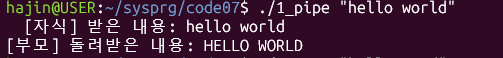
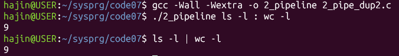

# 시스템 프로그래밍 7주차 실습 — 파이프와 FIFO

## 1. 프로젝트 설명
WSL(Ubuntu) 환경에서 C 언어로 파이프(pipe), `dup2`, FIFO(이름 있는 파이프)를 이용해 프로세스끼리 통신해 보는 실습이다. 모든 프로그램은 `gcc -Wall -Wextra`로 컴파일했다.

- `1_pipe_basic.c` (실행 파일 `1_pipe`) : 파이프 2개로 부모가 보낸 문자열을 자식이 대문자로 바꿔 돌려주는 프로그램
- `2_pipe_dup2.c` (실행 파일 `2_pipeline`) : `./2_pipeline ls -l : wc -l`처럼 `:`로 구분한 두 명령을 `dup2`로 파이프에 이어 붙여 실행하는 프로그램
- `3_fifo_read.c` : FIFO를 만들고 보내는 쪽이 보낸 메시지를 끝까지 받아 출력하는 받는 쪽 프로그램
- `4_fifo_write.c` : 인자로 받은 여러 단어를 FIFO로 하나씩 보내는 보내는 쪽 프로그램

## 2. 프로그램별 결과

### 2-1. 파이프로 왕복 (1_pipe)
`./1_pipe "hello world"`처럼 실행하면 부모가 문자열을 자식에게 보내고, 자식이 대문자로 바꿔 부모에게 돌려준다. 파이프는 한 방향이라 `p2c`(부모→자식), `c2p`(자식→부모) 두 개를 만들었고, 각 프로세스는 쓰지 않는 끝을 닫았다.

실행 화면 (`./1_pipe "hello world"`)

### 2-2. dup2로 명령 이어 붙이기 (2_pipeline)
`./2_pipeline ls -l : wc -l`처럼 실행하면 `argv`에서 `:`를 찾아 앞 명령(`ls -l`)과 뒤 명령(`wc -l`)으로 나눈다. 첫 번째 자식은 표준출력을 파이프 쓰기 끝으로, 두 번째 자식은 표준입력을 파이프 읽기 끝으로 `dup2`로 바꿔치기한 뒤 `execvp`로 각 명령을 실행한다. 부모는 파이프 양쪽을 모두 닫고 자식 둘을 `wait`한다.

셸의 `ls -l | wc -l`과 결과 비교

### 2-3. FIFO로 메시지 주고받기 (3_fifo_read / 4_fifo_write)
받는 쪽(`3_fifo_read`)을 먼저 실행해 FIFO(`/tmp/sysprog_fifo`)를 만들고 기다린다. 보내는 쪽(`4_fifo_write`)은 `./4_fifo_write 사과 바나나 배`처럼 인자로 받은 단어를 하나씩 FIFO에 쓴다. 받는 쪽은 `read`를 반복하다가 보내는 쪽이 FIFO를 닫아 `read`가 0을 돌려주면 반복을 끝내고, `unlink`로 FIFO를 지운다.

받는 쪽 (터미널 A: `./3_fifo_read`)

보내는 쪽 (터미널 B: `./4_fifo_write 사과 바나나 배`)

## 3. AI 사용 내용
- 사용한 AI: Claude
- 도움받은 부분: WSL·VS Code 사용법, 컴파일과 실행 방법, `argc/argv`, `pipe`, `dup2`, FIFO의 개념 설명과 단계별 힌트
- 1번은 힌트를 바탕으로 직접 작성했고, 작성한 코드를 AI에게 보여 주며 문제점을 확인했다.
- 2번의 `:`로 명령을 나누는 부분과 3·4번의 `read` 반복, 여러 단어 전송 부분은 AI가 제시한 코드를 바탕으로 작성했다.

## 4. 본인의 보강 내용
- **1번**: 원본에서 부모가 보내기만 하던 것을, 두 번째 파이프를 추가해 자식이 대문자로 바꿔 돌려주는 왕복 구조로 바꿨다. 고정돼 있던 문자열은 `argv[1]`로 받도록 바꾸고 인자 개수를 검사했다.
- **1번**: `wait`를 부모가 읽기를 끝낸 뒤에 호출하도록 위치를 바꿨고, `read`가 실패한 경우에는 변환과 `write`를 하지 않도록 `if (n > 0)` 안으로 옮겼다.
- **2번**: `ls`, `wc -l`이 코드에 고정돼 있던 것을, `argv`에서 `:`를 찾아 앞뒤 명령으로 나누고 `execvp`로 실행하도록 바꿔 어떤 명령 조합도 이어 붙일 수 있게 했다. `:`가 없거나 앞뒤 명령이 비어 있으면 사용법을 출력한다.
- **3·4번**: 메시지를 한 번만 받던 것을 `read` 반복으로 바꿔 여러 단어를 모두 받게 했고, 보내는 쪽은 단어마다 줄바꿈을 붙여 구분하도록 했다. 받는 쪽은 끝나면 `unlink`로 FIFO를 지운다.
